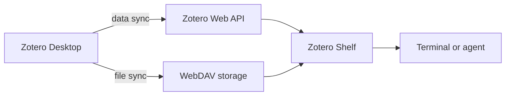

# Zotero Shelf

**Your Zotero library and WebDAV PDFs, in the terminal.**

Search references, read notes, export citations, and fetch PDFs on a remote machine.
Keep using Zotero on your desktop to organize and edit your library. Shelf connects
to your synced account; it does not need Zotero Desktop or a graphical session on
the machine where it runs.



```console
$ zshelf search "second harmonic generation"
$ zshelf show ABCD1234
$ zshelf text ABCD1234 --first-page 1 --last-page 3
$ zshelf export ABCD1234 --output references.bib
```

Example keys above are placeholders. Search returns the keys in your own library.

## Install

Python 3.10 or newer is required. Install directly from this repository:

```bash
pipx install git+https://github.com/yingxingcheng/zotero-shelf.git
# or use your own virtual environment:
python -m pip install git+https://github.com/yingxingcheng/zotero-shelf.git
```

The commands `zshelf` and `zotero-shelf` are equivalent. For PDF text extraction,
install Poppler (`pdftotext`) using your system package manager. Metadata search,
downloads, and synced indexed text work without Poppler.

## Connect your library

```bash
zshelf setup
zshelf check
zshelf search "your topic"
```

Get your numeric user ID and a dedicated API key from
[Zotero API settings](https://www.zotero.org/settings/keys). Enable library and
note read access. Write access is unnecessary. Setup hides the API key, verifies
the connection, and saves the settings outside the checkout with owner-only file
permissions on POSIX systems.

Your desktop must sync library data with zotero.org. Attachment file sync is
separate: this first release downloads stored PDFs from WebDAV. It supports
personal libraries for WebDAV files and user/group libraries for metadata.

## Connect WebDAV PDFs

```bash
zshelf webdav setup                    # Nutstore/Jianguoyun defaults
zshelf webdav setup --provider generic # your own WebDAV service
zshelf webdav check
zshelf download ABCD1234
zshelf text ABCD1234
```

Enter the URL from Zotero's Sync settings, your WebDAV username, and the service's
application password at the hidden prompt. Shelf adds Zotero's `/zotero/` folder
when needed. Digest authentication is available with `--auth digest`.

Nutstore users can generate an application password under Account information →
Security options → Third-party application management.
[Nutstore's instructions](https://help.jianguoyun.com/?p=2064).

Pass a PDF attachment key, or a reference key with one stored PDF. If a reference
has several PDFs, `zshelf children KEY` lists the attachment keys to choose from.
Downloads are cached privately and checked against the synced checksum when
available. `--force` refreshes a cached download; `--output-dir PATH` selects a
different cache directory.

## Work with references

| Command | Purpose |
|---|---|
| `zshelf search "query"` | Search titles, creators and years |
| `zshelf search` | List recently modified references |
| `zshelf collections` | List collections and their keys |
| `zshelf show KEY` | Read metadata for an item |
| `zshelf children KEY` | List notes and attachments |
| `zshelf notes [KEY]` | Read synced notes |
| `zshelf fulltext ATTACHMENT_KEY` | Read Zotero's synced text index |
| `zshelf download KEY` | Download a WebDAV PDF |
| `zshelf text KEY` | Extract PDF text with Poppler |
| `zshelf text KEY --indexed` | Read indexed text without downloading |
| `zshelf export KEY...` | Export BibTeX; use `--format csljson` for CSL JSON |
| `zshelf status` | Show paths and settings without secrets |

Search supports `--collection KEY`, repeatable `--tag TAG`, `--everything`,
`--limit N`, and `--offset N`. Paged results report the next offset. `text` can
read a page range with `--first-page` and `--last-page`. `text` and `export`
accept `-o FILE`; existing files are preserved rather than overwritten.

## Scripts and agents

Use JSON for structured, predictable output:

```bash
zshelf search "density functional theory" --json
zshelf children ABCD1234 --json
zshelf download ABCD1234 --json
```

Any agent with terminal access can invoke these commands. JSON successes go to
stdout; operational errors go to stderr with a nonzero exit code. Shelf exposes
read operations only, so edits continue through your Zotero desktop application.
See [agent usage](docs/agents.md) for a short workflow.

## Configuration and existing HPC installations

Settings normally live under `~/.config/zotero-shelf/` (or the Windows application
data directory). `XDG_CONFIG_HOME` and `XDG_CACHE_HOME` are respected. Override
individual files with `--config PATH` and `--webdav-config PATH`.

Library settings can also come from `ZOTERO_LIBRARY_ID`, `ZOTERO_LIBRARY_TYPE`
(`user` or `group`), and `ZOTERO_API_KEY`. Do not put credentials on command lines,
in public repositories, or in bug reports.

For users of the earlier `zotero-api` HPC scripts, Shelf automatically reads
`~/.config/zotero-api/config.json` and `webdav.json` if its own settings do not
exist. Nothing is copied into the source tree, and the older client keeps working.

## Scope

This is a read-only first release. It does not run a desktop sync engine, upload
files, edit library records, download group-library WebDAV files, or handle linked
local files and HTML snapshots. Direct Zotero Storage downloads and OCR are not
implemented. WebDAV transfers are limited to 512 MiB per attachment. PDF text
quality depends on the document; scanned PDFs may need a separate OCR tool.

## Development

```bash
git clone https://github.com/yingxingcheng/zotero-shelf.git
cd zotero-shelf
python -m pip install -e '.[dev]'
pytest
ruff check .
ruff format --check .
python -m build
twine check dist/*
```

Tests use synthetic records and local HTTP fixtures. They require no Zotero
account and never upload or modify library data. See [contributing](CONTRIBUTING.md)
and [security](SECURITY.md).

## License and acknowledgements

MIT. Built with [Pyzotero](https://github.com/urschrei/pyzotero), HTTPX2 and Rich.
Zotero Shelf is an independent project and is not affiliated with Zotero or
Nutstore. Zotero is a trademark of its respective owner. Protocol references:
[Zotero Web API](https://www.zotero.org/support/dev/web_api/v3/start) and
[Zotero's WebDAV implementation](https://github.com/zotero/zotero/blob/main/chrome/content/zotero/xpcom/storage/webdav.js).
